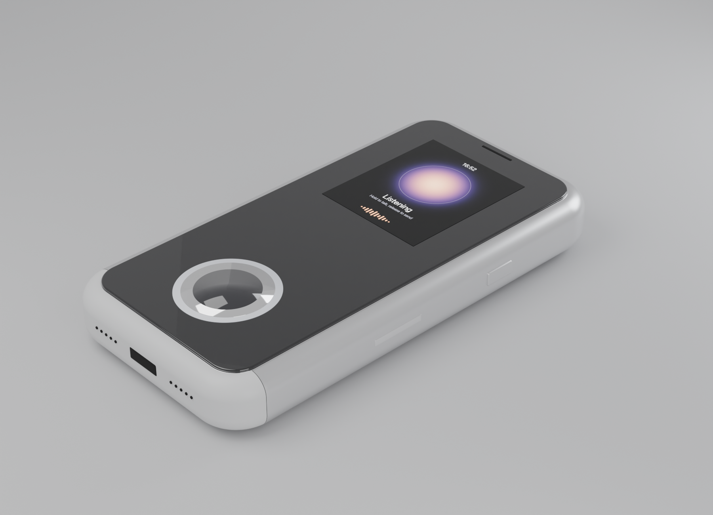
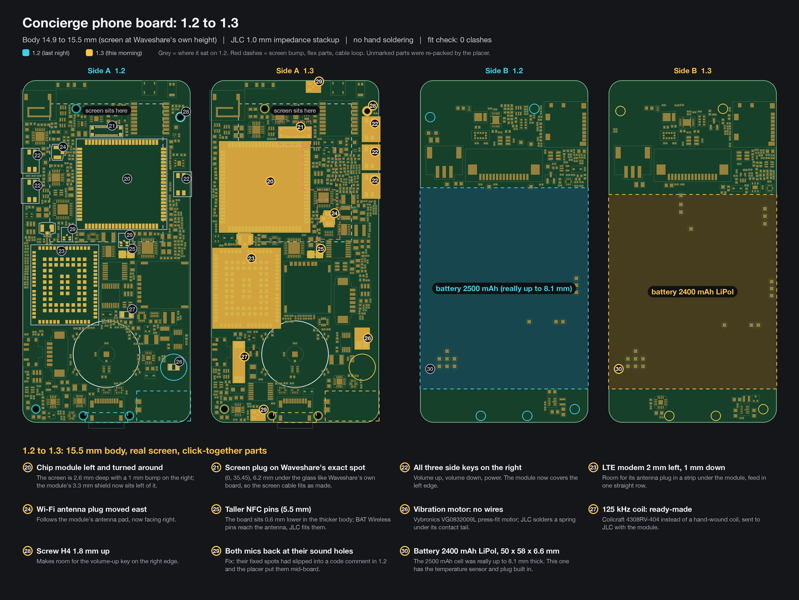

# Concierge phone

A small candybar phone you click and talk to. It sends your voice to an AI concierge in the cloud and talks back, and it carries a whole toolbox of radios and sensors the concierge can use.



**Status: work in progress. Nothing has been built or tested yet.** The board is placed and passes every check except routing, which is running now. Treat everything here as an untested design.

## What's inside

| | |
|---|---|
| Body | 54 x 108 x 15.5 mm, natural aluminium, black glass front |
| Brain | Waveshare ESP32-P4-Module (ESP32-P4 + ESP32-C6 for Wi-Fi 6 and Bluetooth LE) |
| Screen | 1.8" AMOLED with touch |
| Mobile data | Quectel EG915U-EU LTE Cat-1bis, nano-SIM |
| Location | u-blox MAX-M10S GNSS |
| Voice | 2 MEMS mics, MAX98357A amp + speaker, fingerprint Talk key |
| Camera | OV5647, 5 MP |
| Radios | NFC (ST25R3916B), sub-GHz (CC1101), LoRa (SX1262), IR receiver |
| Sensors | air quality (SGP41), colour (AS7341), distance (VL53L1), pressure (BMP581), temperature and humidity (SHT40), motion (ICM-42670), light (OPT3004), compass (MMC5603) |
| Feel | LRA haptics (DRV2605L), 3 side keys, privacy slide switch |
| Power | 2400 mAh LiPo, BQ24074 charger, BQ27441 fuel gauge, USB-C |
| Storage | microSD |
| Board | 50 x 102 mm, 6 layers, 1.0 mm, JLCPCB JLC06101H-3313 stackup |

The board is designed so it goes together with no soldering: the screen, battery, camera, fingerprint reader, antennas and speaker plug in or press onto spring contacts, and the rest is screws.

## How it's made

The whole board is generated by Python scripts that run inside KiCad 10. Nothing is drawn by hand, so every change is a script edit and a re-run.

```
pcb/sch_*.py        netlists for each block (core, power, rf, sense, ui), every part with its datasheet notes
pcb/gen_*.py        footprints KiCad doesn't ship
pcb/make_board.py   builds and places the board
pcb/fit_check.py    3D check that every part fits under the screen, battery and case
pcb/route.py        net classes, impedance widths, export for routing
pcb/quilter_prep.py input files for the Quilter auto-router
pcb/order_check.py  the order gate: DRC, nets, parts stock, fit; prints READY TO ORDER or NOT READY
enclosure/          Blender scripts for the concept renders
research/           part research notes
DESIGN.md           every design decision, in order, with the reasons
```

Run them with KiCad's own Python:

```
KPY=/Applications/KiCad/KiCad.app/Contents/Frameworks/Python.framework/Versions/Current/bin/python3
cd pcb
$KPY make_board.py
$KPY check_nets.py
$KPY export_view.py > shots/board.json
$KPY fit_check.py
$KPY route.py export
$KPY quilter_prep.py
$KPY order_check.py quilter/A-route-only/phone.kicad_pcb 5
```



## Not included

Manufacturer datasheets aren't in this repo; each part's notes in `pcb/sch_*.py` name the document and page they came from. The firmware isn't written yet.

## License

MIT, see [LICENSE](LICENSE). Use it, change it, build it. If you build one, say hi.
